<a href="https://guilherme-digital-lab.web.app/">
  <picture>
    <source media="(prefers-color-scheme: dark)" srcset="assets/abertura-noite.webp">
    
  </picture>
</a>

Sou analista de Pricing em Campinas, SP, e trabalho na ponte entre inteligência comercial, dados e automação. Construo coletores de preços, pipelines no Airflow, agentes de IA, robôs de WhatsApp e sistemas web: do problema da operação até a solução rodando.

Antes de programar, passei anos em operação e atendimento, em hospitais e centrais de relacionamento. Vem de lá o hábito de entender o processo antes de automatizar.

  <a href="https://guilherme-digital-lab.web.app/"><picture><source media="(prefers-color-scheme: dark)" srcset="assets/botao-portfolio-noite.webp"></picture></a>&nbsp;
  <a href="https://www.linkedin.com/in/guilhermekawe/"><picture><source media="(prefers-color-scheme: dark)" srcset="assets/botao-linkedin-noite.webp"></picture></a>&nbsp;
  <a href="https://wa.me/5519920004192?text=Ol%C3%A1%2C%20Guilherme%21%20Vi%20seu%20GitHub%20e%20quero%20conversar%20sobre%20um%20projeto."><picture><source media="(prefers-color-scheme: dark)" srcset="assets/botao-whatsapp-noite.webp"></picture></a>

  <picture><source media="(prefers-color-scheme: dark)" srcset="assets/numero-dags-noite.webp">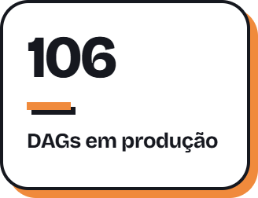</picture>&nbsp;
  <picture><source media="(prefers-color-scheme: dark)" srcset="assets/numero-precos-noite.webp">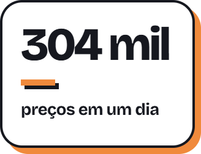</picture>&nbsp;
  <picture><source media="(prefers-color-scheme: dark)" srcset="assets/numero-tempo-noite.webp">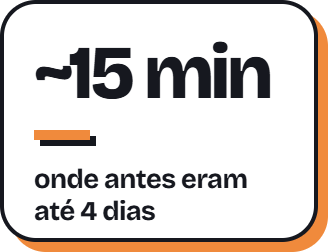</picture>&nbsp;
  <picture><source media="(prefers-color-scheme: dark)" srcset="assets/numero-sites-noite.webp">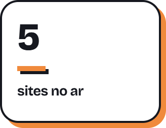</picture>

<a href="https://guilherme-digital-lab.web.app/">
  <picture>
    <source media="(prefers-color-scheme: dark)" srcset="assets/laboratorio-noite.webp">
    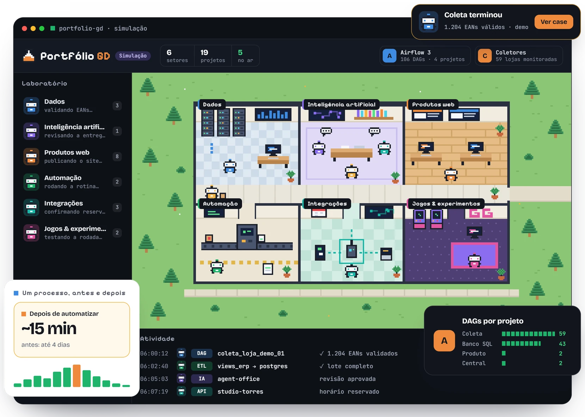
  </picture>
</a>

O laboratório que abre o portfólio: seis setores e 19 projetos. Lá cada case tem telas reais, trechos de código e simulações com dados fictícios.

## Destaques

<a href="https://guilherme-digital-lab.web.app/projetos/airflow-control-center.html">
  <picture>
    <source media="(prefers-color-scheme: dark)" srcset="assets/case-airflow-noite.webp">
    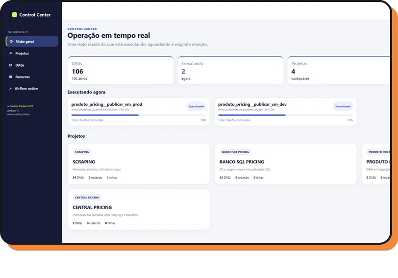
  </picture>
</a>

### [Airflow 3: Control Center](https://guilherme-digital-lab.web.app/projetos/airflow-control-center.html)

**Em produção** · projeto corporativo

Criei o painel que opera 106 DAGs de coleta, ETL e publicação: tudo em uma tela, sem SSH nem JSON editado à mão. Logs ao vivo e deploy por GitHub Actions com rollback automático.

`Airflow 3` `Python` `PostgreSQL` `GitHub Actions`

 

<a href="https://guilherme-digital-lab.web.app/projetos/coletores-precos.html">
  <picture>
    <source media="(prefers-color-scheme: dark)" srcset="assets/case-coletores-noite.webp">
    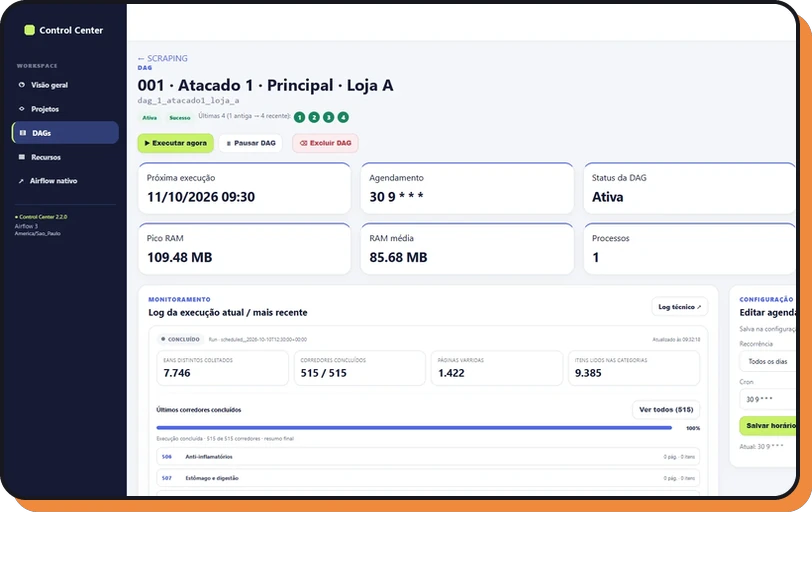
  </picture>
</a>

### [Coletores de preços](https://guilherme-digital-lab.web.app/projetos/coletores-precos.html)

**Em produção** · projeto corporativo

Robôs em Python que leem a API das lojas virtuais e trazem todos os preços, com o código de barras conferido. Numa execução real, uma loja inteira foi lida em 16 min 37 s: 7.746 produtos com EAN válido.

`Python` `Web scraping` `Airflow` `PostgreSQL` `pytest`

 

<a href="https://guilherme-digital-lab.web.app/projetos/robo-whatsapp.html">
  <picture>
    <source media="(prefers-color-scheme: dark)" srcset="assets/case-robo-noite.webp">
    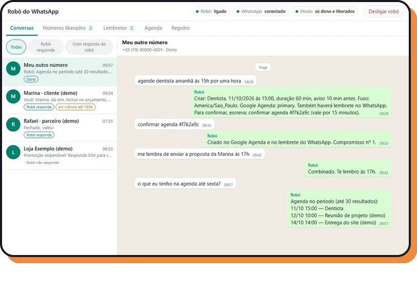
  </picture>
</a>

### [Robô de WhatsApp com IA](https://guilherme-digital-lab.web.app/projetos/robo-whatsapp.html)

**Em uso** · aplicativo local

Um assistente que responde no meu WhatsApp e marca compromissos no Google Agenda, com prévia e código de confirmação. São 144 testes automatizados; a tela usa conversas fictícias.

`Python` `Docker` `WAHA` `Claude` `Google Calendar API`

 

<a href="https://guilherme-digital-lab.web.app/projetos/agent-office.html">
  <picture>
    <source media="(prefers-color-scheme: dark)" srcset="assets/case-agent-office-noite.webp">
    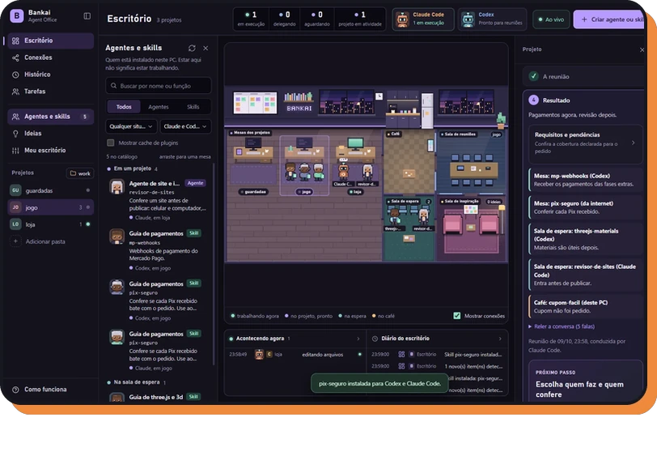
  </picture>
</a>

### [Bankai Agent Office](https://guilherme-digital-lab.web.app/projetos/agent-office.html)

**Aplicativo local** · versão 2.8.0

Um escritório em pixel art onde agentes e skills de IA são escalados para cada projeto. A tarefa só conclui com teste e revisão aprovados.

`Electron` `JavaScript` `Claude Code` `Codex` `MCP`

 

<a href="https://guilherme-digital-lab.web.app/projetos/dedo-nervoso.html">
  <picture>
    <source media="(prefers-color-scheme: dark)" srcset="assets/case-dedo-noite.webp">
    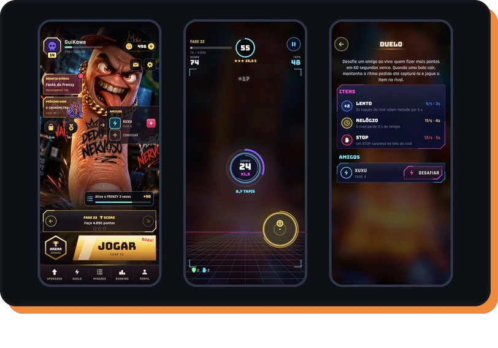
  </picture>
</a>

### [Dedo Nervoso](https://guilherme-digital-lab.web.app/projetos/dedo-nervoso.html)

**Jogo para Android** · versão 1.3.1

Jogo de toques em Kotlin nativo, sem motor de jogos, em 4 MB. Tem fases, chefes, ranking online e duelo ao vivo; regras no servidor recusam pontuação impossível.

`Android` `Kotlin` `Canvas` `Firebase` `Firestore`

 

## Sites e experimentos

<table>
  <tr>
    <td width="33%" valign="top">
      <a href="https://guilherme-digital-lab.web.app/projetos/despachante-barao.html"><picture><source media="(prefers-color-scheme: dark)" srcset="assets/site-barao-noite.webp">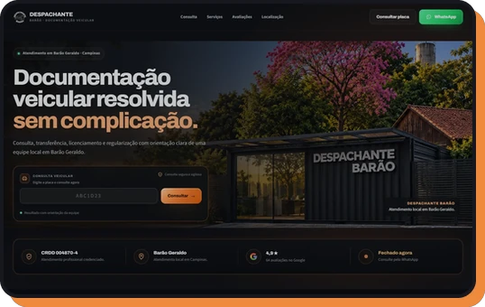</picture></a> 
      <b>Despachante Barão</b> Em produção
    </td>
    <td width="33%" valign="top">
      <a href="https://guilherme-digital-lab.web.app/projetos/studio-torres.html"><picture><source media="(prefers-color-scheme: dark)" srcset="assets/site-torres-noite.webp"></picture></a> 
      <b>Studio Torres</b> Em testes
    </td>
    <td width="33%" valign="top">
      <a href="https://guilherme-digital-lab.web.app/projetos/redmoon.html"><picture><source media="(prefers-color-scheme: dark)" srcset="assets/site-redmoon-noite.webp">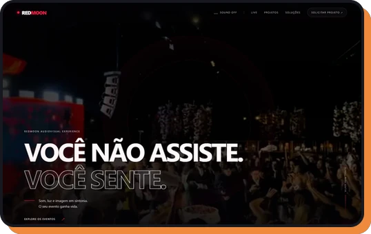</picture></a> 
      <b>Redmoon Eventos</b> Em avaliação pelo cliente
    </td>
  </tr>
  <tr>
    <td width="33%" valign="top">
      <a href="https://guilherme-digital-lab.web.app/projetos/bankai-tech.html"><picture><source media="(prefers-color-scheme: dark)" srcset="assets/site-bankai-noite.webp">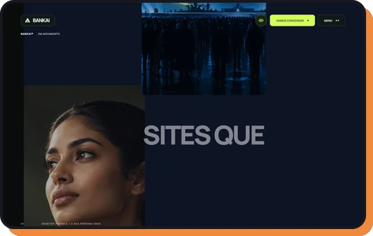</picture></a> 
      <b>Bankai Tech</b> Publicado
    </td>
    <td width="33%" valign="top">
      <a href="https://guilherme-digital-lab.web.app/projetos/pastelaria3g.html"><picture><source media="(prefers-color-scheme: dark)" srcset="assets/site-pastelaria-noite.webp">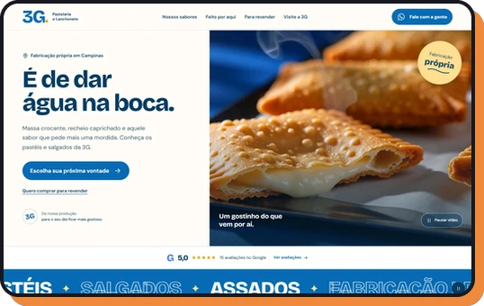</picture></a> 
      <b>Pastelaria 3G</b> Publicado
    </td>
    <td width="33%" valign="top">
      <a href="https://guilherme-digital-lab.web.app/projetos/invasao-cosmica.html"><picture><source media="(prefers-color-scheme: dark)" srcset="assets/site-invasao-noite.webp">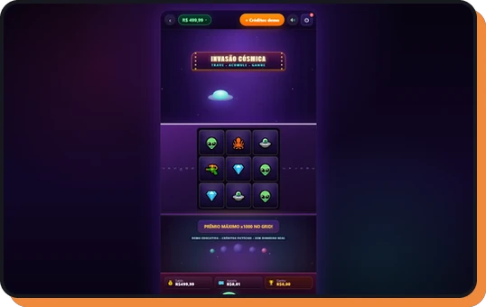</picture></a> 
      <b>Invasão Cósmica</b> Experimento jogável
    </td>
  </tr>
</table>

## Ferramentas

| Área | No dia a dia |
| :-- | :-- |
| Linguagens | Python · SQL · JavaScript · Kotlin · HTML e CSS |
| Dados | PostgreSQL · SQLite · Apache Airflow · ETL · web scraping · EAN/GTIN · pytest |
| Servidores e deploy | Linux · SSH · Docker · WSL · Git e GitHub · GitHub Actions |
| Back-end e web | Node.js · FastAPI · React · Electron · Three.js |
| Nuvem | Firebase · Google Cloud · Cloudflare Workers |
| Integrações | WhatsApp · Google Agenda · Mercado Pago · APIs REST |
| IA aplicada | Claude Code · Codex · agentes · MCP · Skills |
| Pricing e análise | ERP WinThor · Excel avançado · Power BI · Google Sheets |

## Sobre os repositórios

A maior parte destes projetos é da empresa em que trabalho ou de clientes, por isso o código fica em repositórios privados. O [portfólio](https://guilherme-digital-lab.web.app/) abre cada projeto por dentro: o problema, a solução, telas reais anonimizadas e trechos de código.

## Vamos conversar

Tem um processo manual que toma horas da sua equipe? Me conta como ele funciona hoje.

  <a href="https://guilherme-digital-lab.web.app/"><picture><source media="(prefers-color-scheme: dark)" srcset="assets/botao-portfolio-noite.webp"></picture></a>&nbsp;
  <a href="https://www.linkedin.com/in/guilhermekawe/"><picture><source media="(prefers-color-scheme: dark)" srcset="assets/botao-linkedin-noite.webp"></picture></a>&nbsp;
  <a href="https://wa.me/5519920004192?text=Ol%C3%A1%2C%20Guilherme%21%20Vi%20seu%20GitHub%20e%20quero%20conversar%20sobre%20um%20projeto."><picture><source media="(prefers-color-scheme: dark)" srcset="assets/botao-whatsapp-noite.webp"></picture></a>

<a href="https://guilherme-digital-lab.web.app/">guilherme-digital-lab.web.app</a> · <a href="https://www.linkedin.com/in/guilhermekawe/">linkedin.com/in/guilhermekawe</a>

